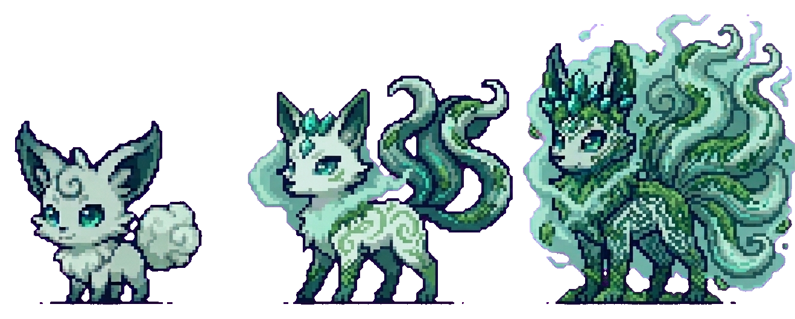

# 01 · Vụ Hồ (Sương Cốc)

- **Vùng:** Sương Cốc (vùng 1)
- **Loài:** Vụ Hồ, con số 01 trong 10 loài của vùng. Khung là **cáo** (bản giả tưởng): thú bốn chân nhỏ nhanh nhẹn, tai to, đuôi xù như sương. Môi trường: mặt đất.
- **Tên:** Vụ Hồ, dùng chung cho cả 3 bậc.
- **Ảnh:** `suong-coc-01-vu-ho.png` (ở thư mục gốc của nhánh), 1318×531, 1 ảnh gồm 3 bậc xếp ngang, trái → phải = Bậc 1 → 2 → 3. Làm từ **ảnh gốc 1376×768 nền magenta** do người dùng gửi (bản Canva 688×290 trước đó đã bị thay). Đã tách nền (khoảng cách màu < 70, alpha cứng 0/255), **xoá dấu sao**, xoá pixel ám hồng ở mép, thay các đốm hồng bên trong bằng màu lân cận, cắt sát bbox chừa lề 24px, không thu nhỏ. Còn vài mảnh rời nhỏ (đốm sương, hạt ngọc) là thiết kế, đã giữ.

## Đặc điểm hình ảnh
- Bảng màu xanh ngọc, xanh rêu, trắng sương, viền navy; không tím / hồng.
- Bậc 1: cáo con tai rất to, mắt tròn ngọc lục bảo, họa tiết xoáy sương trên trán, đuôi là cục bông sương tròn.
- Bậc 2: cáo trưởng thành, đứng nghiêng, tinh thể ngọc trên trán, họa tiết xoáy rêu trên thân, đuôi dài uốn lượn có sọc rêu.
- Bậc 3: to nhất, vương miện tinh thể ngọc, giáp rêu và vảy trên thân, nhiều đuôi sương cuộn như cáo nhiều đuôi, quầng sương dày quanh người.

## Điểm chưa ổn
- Bậc 1 nhìn gần như chính diện, không quay trái như prompt yêu cầu (người dùng chấp nhận, không sửa).
- Bậc 3: mặt và thân bị quầng sương dày bao quanh, thân hơi chìm vào đuôi; mép phải của quầng sương chạm sát mép ảnh gốc nên bị cắt phẳng (người dùng chấp nhận).
- Vạch bóng đổ dưới chân mờ, một phần bị xoá do ám hồng (chi tiết nhỏ, người dùng chấp nhận).
- Không phải lưới pixel đều, giống các con trước.

## Lưu ý khi cắt
- Bậc 3 có quầng sương rộng, chừa lề cả bốn phía; cân nhắc bớt sương khi ra sprite 128×128.
- Kiểm tra độ đọc của mắt Bậc 3 khi thu nhỏ.
