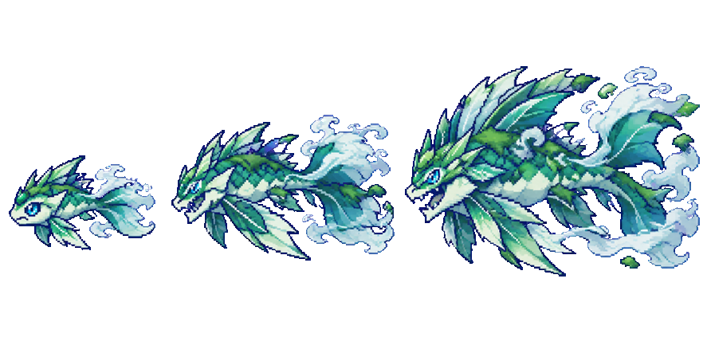

# 02 · Sương Ngư (Sương Cốc)

- **Vùng:** Sương Cốc (vùng 1)
- **Loài:** Sương Ngư, con số 02 trong 10 loài của vùng. Khung là **cá chép** (bản giả tưởng): cá nhìn ngang, vây như lá, đuôi dải sương, vảy ngọc. Môi trường: dưới nước.
- **Tên:** Sương Ngư, dùng chung cho cả 3 bậc.
- **Ảnh:** `suong-coc-02-suong-ngu.png` (ở thư mục gốc của nhánh), 887×443, RGBA, 1 ảnh gồm 3 bậc xếp ngang, trái → phải = Bậc 1 → 2 → 3. Người dùng đã tự xoá nền (không còn magenta), Claude xử lý tiếp: **xoá đốm tím / hồng** (đã tô lại bằng màu lân cận, gồm cả vài pixel ám tím nhạt ở mép sương Bậc 3), alpha cứng 0/255 (bỏ viền bán trong suốt), bỏ vài mảnh rời cực nhỏ (< 30 px) ngoài bảng màu. Không thu nhỏ. Còn 8 mảnh rời (3 thân, đốm sương, mảnh lá xanh) là thiết kế, đã giữ.

## Đặc điểm hình ảnh
- Bảng màu xanh ngọc, xanh rêu, trắng sương, viền navy; mắt xanh cyan có điểm sáng; không tím / hồng (đã kiểm: 0 pixel tím / hồng).
- Bậc 1: cá con đầu tròn, mắt to, mào lá nhỏ, vây ngực lá, đuôi dải sương.
- Bậc 2: thân dài hơn, vảy ngọc ô trám, mào lá nhiều tầng, vây lưng và vây bụng dạng lá, đuôi sương rộng, miệng hé.
- Bậc 3: to nhất, mào lá lớn, vảy ô trám và mảng rêu trên lưng, vây lá dài, đuôi sương cuộn dày, miệng há có răng, vài mảnh lá xanh bay quanh.

## Điểm chưa ổn
- Dáng Bậc 3 hơi giống rồng / thủy long hơn cá chép (người dùng chưa phản đối).
- Quầng sương Bậc 3 lớn, chiếm nhiều chỗ bên phải.
- Không phải lưới pixel đều, giống các con trước.

## Lưu ý khi cắt
- Bậc 2 và Bậc 3 có vây lá và dải sương vươn rộng, chừa lề cả bốn phía; cân nhắc bớt sương khi ra sprite 128×128.
- Kiểm tra độ đọc của mắt Bậc 1 khi thu nhỏ (mắt nhỏ nhất).
