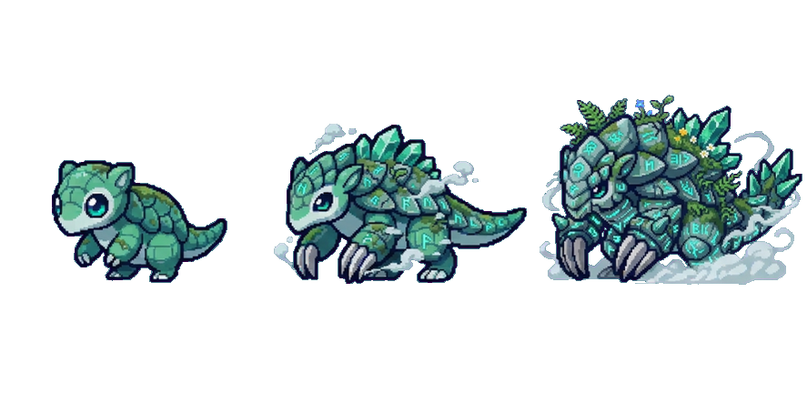

# 03 · Sương Xuyên (Sương Cốc)

- **Vùng:** Sương Cốc (vùng 1)
- **Loài:** Sương Xuyên, con số 03 trong 10 loài của vùng. Khung là **tê tê** (bản giả tưởng): thú bốn chân thấp, thân dài, vảy đá phủ rêu, móng đào to, đuôi dày. Môi trường: lòng đất.
- **Tên:** Sương Xuyên, dùng chung cho cả 3 bậc.
- **Ảnh:** `suong-coc-03-suong-xuyen.png` (ở thư mục gốc của nhánh), 887×443, RGBA, 1 ảnh gồm 3 bậc xếp ngang, trái → phải = Bậc 1 → 2 → 3. Người dùng đã tự xoá nền, Claude xử lý tiếp: **xoá dấu sao hồng góc dưới phải**, **đổi màu sương ám tím / hồng sang xanh xám trắng** (tô theo độ sáng, gồm cả viền hồng quanh sương Bậc 3), alpha cứng 0/255, bỏ mảnh rời cực nhỏ (< 30 px). Không thu nhỏ. Còn 7 mảnh rời (3 thân, vài đốm sương) là thiết kế, đã giữ.

## Đặc điểm hình ảnh
- Bảng màu xanh ngọc, xanh rêu, trắng sương, viền navy; mắt cyan có điểm sáng; không tím / hồng (đã kiểm: 0 pixel).
- Bậc 1: tê tê con tròn, mắt to, vảy ô tròn nhẹ, vài mảng rêu, đuôi ngắn có vảy.
- Bậc 2: dài hơn, vảy đá tấm, hàng tinh thể ngọc xanh dọc lưng, móng dài, vài sợi sương, chữ rune cyan trên thân.
- Bậc 3: to nhất, giáp đá nhiều lớp phủ rêu và cây (dương xỉ, hoa vàng / xanh nhỏ), móng đào rất lớn, đuôi gai tinh thể, sương cuộn thấp quanh chân.

## Điểm chưa ổn
- Móng vuốt màu xám trung tính (prompt cấm xám); giữ vì hợp thiết kế, chưa đổi.
- Sương sau khi đổi màu hơi xám xanh, đậm hơn sương Sương Ngư.
- Bậc 3 nhiều chi tiết (cây, hoa, rune, tinh thể), có thể rối khi thu nhỏ về 128×128.
- Bậc 3 dáng gần golem đá (gần Golem Băng Giá / Băng Sơn Cự Thú ở Tuyết Nguyên); người dùng chưa phản đối.
- Không phải lưới pixel đều, giống các con trước.

## Lưu ý khi cắt
- Sương Bậc 2 / 3 và gai đuôi Bậc 3 vươn ra ngoài thân, chừa lề bốn phía.
- Hoa nhỏ và dương xỉ trên lưng Bậc 3 là thiết kế (đừng xoá khi dọn mảnh rời).
- Kiểm tra độ đọc của rune và mắt Bậc 1 khi thu nhỏ.
