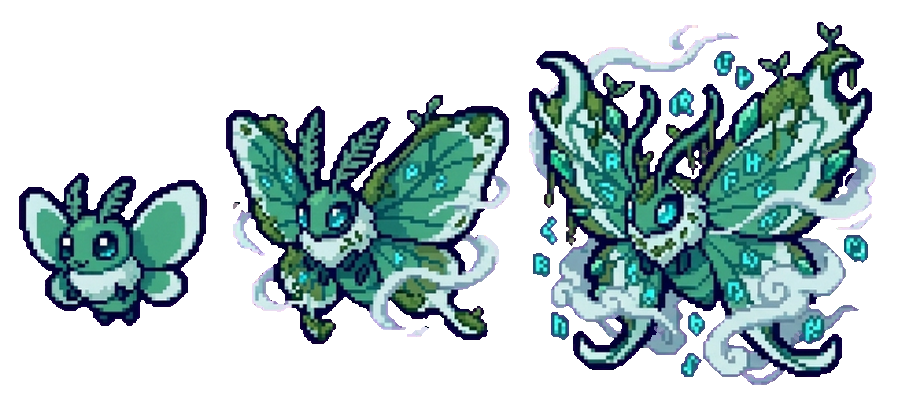

# 04 · Vụ Điệp (Sương Cốc)

- **Vùng:** Sương Cốc (vùng 1)
- **Loài:** Vụ Điệp, con số 04 trong 10 loài của vùng. Khung là **bướm đêm** (bản giả tưởng): cánh rộng đối xứng, râu lông vũ, vảy sương. Môi trường: trên trời.
- **Tên:** Vụ Điệp, dùng chung cho cả 3 bậc.
- **Ảnh:** `suong-coc-04-vu-diep.png` (ở thư mục gốc của nhánh), 899×408, RGBA, 1 ảnh gồm 3 bậc xếp ngang, trái → phải = Bậc 1 → 2 → 3. Người dùng đã tự xoá nền, Claude xử lý tiếp: **xoá dấu sao hồng góc dưới phải**, **tô lại đốm ám tím / hồng** (còn 0 pixel), alpha cứng 0/255, bỏ mảnh rời cực nhỏ (< 30 px), cắt sát chừa lề 24px. Không thu nhỏ. Còn 16 mảnh rời (3 thân, đốm sương, chữ rune cyan, mầm cây) là thiết kế, đã giữ.
- **Lưu ý tên file:** ảnh người dùng gửi có tên gốc `suong-coc-03-suong-xuyen (1).png` nhưng nội dung là Vụ Điệp. Khi upload phải đặt tên `suong-coc-04-vu-diep.png`, KHÔNG upload đè lên ảnh 03.

## Đặc điểm hình ảnh
- Bảng màu xanh ngọc, xanh rêu, trắng sương, viền navy; mắt cyan có điểm sáng; không tím / hồng.
- Bậc 1: bướm con tròn, mắt to, cánh bầu xanh ngọc nhạt, râu nhỏ như lá, thân trắng sương.
- Bậc 2: cánh lớn có gân lá và đốm ngọc cyan, rêu phủ mép cánh, râu lông vũ, mầm cây nhỏ trên cánh, dải sương mỏng quanh thân.
- Bậc 3: to nhất, cánh gai nhọn có tinh thể ngọc và rêu rủ, dây leo trên đầu, nhiều chữ rune cyan trôi quanh, sương cuộn dày dưới thân, chân là lưỡi cong dài.

## Điểm chưa ổn
- Bậc 3 nhiều chi tiết (rune, dây leo, sương, tinh thể), có thể rối khi thu nhỏ về 128×128.
- Sương dưới Bậc 3 hơi xám xanh, nhiều tầng, che bớt thân.
- Dáng cánh xoè dễ nhận ra, nhưng Bậc 2 và Bậc 3 nhìn xéo ba phần tư, Bậc 1 nhìn thẳng: khác góc nhìn, cần để ý khi đặt cạnh nhau trong game.
- Không phải lưới pixel đều, giống các con trước.

## Lưu ý khi cắt
- Sương và rune Bậc 3 vươn xa ra ngoài thân, chừa lề bốn phía.
- Rune cyan rời là thiết kế (đừng xoá khi dọn mảnh rời); mầm cây nhỏ trên đỉnh cánh cũng giữ.
- Kiểm tra độ đọc của mắt Bậc 1 và gân cánh Bậc 2 khi thu nhỏ.
