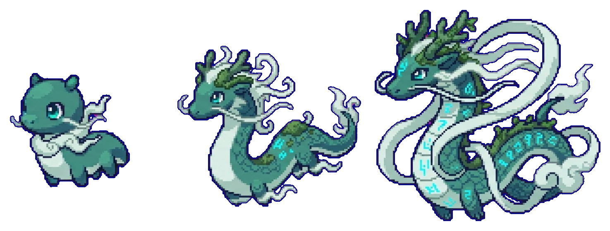

# 06 · Vụ Long (Sương Cốc)

- **Vùng:** Sương Cốc (vùng 1)
- **Loài:** Vụ Long, con số 06 trong 10 loài của vùng. Khung là **rồng thần thoại phương Đông** (bản giả tưởng): thân dài uốn lượn, 4 chân ngắn, sừng nhánh phủ rêu, râu và bờm bằng dải sương. Môi trường: trời / nước.
- **Tên:** Vụ Long, dùng chung cho cả 3 bậc.
- **Ảnh:** `suong-coc-06-vu-long.png` (ở thư mục gốc của nhánh). **CHƯA xử lý**: ảnh Canva gốc (~1584×672) vẫn còn nền magenta (#FF00FF) và dấu sao Gemini ở góc dưới phải. Phiên này không có file ảnh trên máy (chỉ xem được trong hội thoại), nên chưa tách nền / xoá sao được. PNG người dùng tự upload; khi có file thì xử lý theo `XU_LY_ANH_VA_GIT.md` mục A.

## Đặc điểm hình ảnh
- Bảng màu xanh ngọc đậm, xanh ngọc, xanh rêu, trắng sương, viền navy; mắt cyan có điểm sáng, đọc rõ ở cả 3 bậc; cả 3 bậc cùng nhìn sang trái.
- Bậc 1: thú con tròn mập, đầu to, hai tai nhỏ, khăn sương trắng quanh cổ, 4 chân ngắn.
- Bậc 2: rồng cổ dài, thân uốn chữ S, sừng nhánh rêu, râu và bờm sương cuộn, đuôi kết bằng dải sương, vài rune cyan trên lưng.
- Bậc 3: to nhất, cổ dựng, sừng rêu lớn, hai dải sương trắng lớn cuộn thành vòng quanh thân, rune cyan dọc bụng và đuôi, đuôi cuộn tròn kết bằng sương.

## Điểm chưa ổn
- **Bậc 1 không phải rồng**: là thú tròn 4 chân giống gấu / hà mã con, thân ngắn, không có sừng nhánh hay râu dài; khác dáng Bậc 2-3 (prompt đã yêu cầu cùng dáng thân dài). Nếu muốn chỉnh, làm lại riêng Bậc 1 với thân dài hơn, sừng nhỏ, râu sương rõ.
- Bậc 3 nhiều chi tiết (rune, rêu, hai dải sương lớn, đuôi cuộn), trái yêu cầu "ít chi tiết", dễ rối khi thu nhỏ về 128×128; thân bị dải sương che một phần.
- Rune cyan là chi tiết thêm, prompt không yêu cầu (giống Vụ Hạc); giữ vì hợp thiết kế.
- Sương là trắng xanh nhạt, trên nền sáng dễ chìm; viền navy ở dải sương Bậc 3 mỏng hơn thân.
- Bậc 3 không còn dáng chữ S rõ như Bậc 2.
- Không phải lưới pixel đều, giống các con trước.

## Lưu ý khi cắt
- Sương và dải bờm vươn ra ngoài thân ở Bậc 2-3, chừa lề bốn phía.
- Đuôi Bậc 2 và vòng sương Bậc 3 có mảnh rời nhỏ, là thiết kế, đừng xoá khi dọn mảnh rời.
- Xoá dấu sao góc dưới phải trước khi tách nền.
