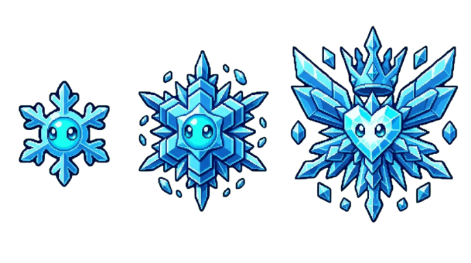

# 02 · Tuyết Tinh (Tuyết Nguyên)

- **Vùng:** Tuyết Nguyên (vùng 0)
- **Loài:** Tuyết Tinh (bông tuyết sáu cánh kết tinh), con số 2 trong 10 loài của vùng. Thú sáng tạo, không dựa trên con vật có thật. Dáng góc cạnh, đối xứng, khác hẳn dáng tròn của Tuyết Cầu.
- **Ảnh:** `02-tuyet-tinh.png` (ở thư mục gốc của nhánh), 688×384, 1 ảnh gồm 3 bậc xếp ngang, trái → phải = Bậc 1 → 2 → 3. Pixel art kiểu Pokémon, **nền trong suốt**, chưa cắt riêng từng bậc. Không có vạch bóng đổ dưới chân.

| Bậc | Tên (đề xuất) |
|---|---|
| Bậc 1 | Tuyết Tinh |
| Bậc 2 | Băng Tinh |
| Bậc 3 | Băng Tâm Vương |

## Đặc điểm hình ảnh
- Bảng màu xanh băng / xanh dương / cyan / trắng băng, viền navy đậm, đổ bóng theo mảng.
- Bậc 1: bông tuyết sáu cánh nhỏ, nét đơn giản, hai mắt tròn bóng ở giữa.
- Bậc 2: lớn hơn, nhiều lớp hình lục giác như tinh thể băng, lõi giữa có mặt, hai mắt tròn, vài mảnh băng nhỏ lơ lửng quanh thân.
- Bậc 3: lõi pha lê hình trái tim ở giữa, vương miện băng trên đỉnh, sáu cánh tinh thể xòe rộng, nhiều mảnh băng hình thoi lơ lửng bên dưới và hai bên. Không còn mắt tròn như hai bậc trước, thay bằng lõi trái tim.

## Lưu ý khi cắt
- Bậc 2 và Bậc 3 có mảnh băng lơ lửng ngoài thân; Bậc 3 xòe rộng nhất (cánh + vương miện): chừa lề rộng hơn Bậc 1 để khỏi mất hiệu ứng.
- Tên các bậc là đề xuất, cách đặt tên bậc của game vẫn chưa chốt.
