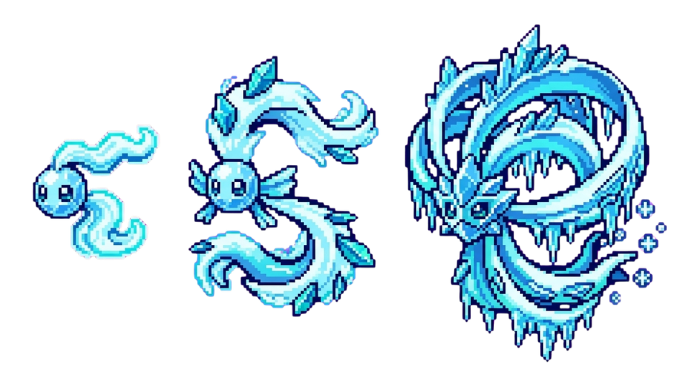

# 03 · Tuyết Quang (Tuyết Nguyên)

- **Vùng:** Tuyết Nguyên (vùng 0)
- **Loài:** Tuyết Quang (linh hồn cực quang), con số 3 trong 10 loài của vùng. Thú sáng tạo, không dựa trên con vật có thật. Dáng dài, cong, uốn lượn, khác dáng tròn của Tuyết Cầu và dáng góc cạnh của Tuyết Tinh.
- **Ảnh:** `03-tuyet-quang.png` (ở thư mục gốc của nhánh), 688×384, 1 ảnh gồm 3 bậc xếp ngang, trái → phải = Bậc 1 → 2 → 3. Pixel art kiểu Pokémon, **nền trong suốt**, chưa cắt riêng từng bậc. Không có vạch bóng đổ dưới chân.

- **Tên:** Tuyết Quang, dùng chung cho cả 3 bậc (không đặt tên riêng từng bậc).

## Đặc điểm hình ảnh
- Bảng màu toàn tông xanh băng / xanh dương / cyan / trắng băng. Ảnh chưa có màu lục cực quang như prompt đã mở ra.
- Bậc 1: quả cầu pha lê tròn nhỏ, hai mắt tròn, một dải cực quang cuộn lượn lên trên và một dải ở phía dưới như đuôi.
- Bậc 2: mặt tròn hai mắt cùng hai vây nhỏ hai bên, thân tách thành hai dải cực quang uốn chữ S lên trên và xuống dưới, gắn vài mảnh tinh thể.
- Bậc 3: thân dài uốn thành nhiều vòng cuộn lớn, đầu có tinh thể và mắt sắc, nhũ băng treo quanh thân, vài bông tuyết nhỏ hình dấu cộng lơ lửng bên phải.

## Lưu ý khi cắt
- Bậc 3 lớn và rộng nhất, nhũ băng treo thấp bên dưới: chừa lề rộng phía dưới và bên phải (có hai bông tuyết nhỏ rời ngoài thân).
- Bậc 1 và Bậc 2 viền nhạt, mềm; Bậc 3 viền navy đậm rõ. Khi đặt cạnh nhau trong game, nét viền của Bậc 3 sẽ đậm hơn hai bậc trước.
