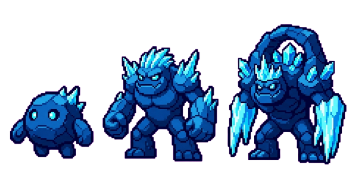

# 04 · Golem Băng Giá (Tuyết Nguyên)

- **Vùng:** Tuyết Nguyên (vùng 0)
- **Loài:** Golem Băng Giá (golem đá hang băng), con số 4 trong 10 loài của vùng. Thú sáng tạo, dáng nặng, đứng hai chân, có tay chân rõ ràng, khác hẳn ba con trước (tròn / bông tuyết / dải uốn lượn).
- **Tên:** Golem Băng Giá, dùng chung cho cả 3 bậc (không đặt tên riêng từng bậc).
- **Ảnh:** `04-golem-bang-gia.png` (ở thư mục gốc của nhánh), 688×384, 1 ảnh gồm 3 bậc xếp ngang, trái → phải = Bậc 1 → 2 → 3. Pixel art kiểu Pokémon, **nền trong suốt**, chưa cắt riêng từng bậc. Đã xóa dấu sao hồng của trình tạo ảnh ở góc dưới phải.

## Đặc điểm hình ảnh
- Bảng màu xanh navy đậm / xanh dương cho phần đá, cyan / trắng băng cho phần băng và tinh thể. Viền navy đậm, cùng độ dày ở cả 3 bậc.
- Bậc 1: cục đá tròn nhỏ, hai chân ngắn bè, hai tay nhỏ, vài mảnh băng nhọn trên lưng, hai mắt tròn sáng.
- Bậc 2: đứng thẳng, vạm vỡ, nắm đấm to, mảnh băng mọc ở vai và trên đầu như tóc, mắt sắc hơn.
- Bậc 3: to lớn nhất, lưng có vòm đá cong qua đầu gắn cụm tinh thể xanh sáng, hai tay là nhũ băng khổng lồ, vương miện băng trên đầu.

## Lưu ý khi cắt
- Bậc 3 cao và rộng nhất: vòm đá trên lưng cao hơn đầu, nhũ băng hai tay buông xuống thấp. Chừa lề trên và hai bên cho đủ.
- Thân đá màu navy đậm gần trùng màu viền navy nên đường viền gần như chìm vào thân; trên nền game tối thì thân dễ lẫn vào nền. Nên thử đặt lên nền thật của game trước khi chốt.
