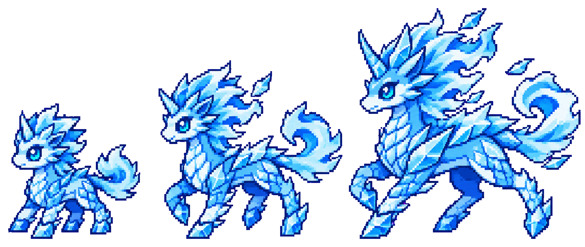

# 06 · Băng Kỳ Lân (Tuyết Nguyên)

- **Vùng:** Tuyết Nguyên (vùng 0)
- **Loài:** Băng Kỳ Lân (kỳ lân băng), con số 6 trong 10 loài của vùng. Thú thần thoại bốn chân, dáng chạy nhanh, đầu giống rồng, một sừng, bờm là các tinh thể băng hình ngọn lửa lạnh, vảy băng ở ngực và chân.
- **Tên:** Băng Kỳ Lân, dùng chung cho cả 3 bậc (không đặt tên riêng từng bậc).
- **Ảnh:** `06-bang-ky-lan.png` (ở thư mục gốc của nhánh), 1727×729, 1 ảnh gồm 3 bậc xếp ngang, trái → phải = Bậc 1 → 2 → 3. Pixel art kiểu Pokémon, chưa cắt riêng từng bậc. Ảnh gốc nền magenta; đã tách thành **nền trong suốt** (alpha chỉ có 0 hoặc 255), đã tô lại pixel viền bị ám màu nền, đã cắt sát với lề 24px. Lớn hơn các ảnh trước (688×384) khoảng 2,5 lần.

## Đặc điểm hình ảnh
- Bảng màu xanh băng / xanh dương / cyan / trắng băng, viền navy đậm cùng độ dày ở cả 3 bậc. Thân sáng.
- Bậc 1: kỳ lân con nhỏ, một sừng ngắn, bờm ngắn dựng như gai băng, mắt tròn to màu cyan, đuôi cuộn như ngọn lửa băng.
- Bậc 2: gọn và dài hơn, bờm tinh thể hình ngọn lửa, vảy băng ở ngực và chân, đang chạy với một chân trước nhấc lên, đuôi cuộn lớn.
- Bậc 3: to và uy nghi nhất, sừng dài, bờm xòe lớn như ngọn lửa lạnh, tấm tinh thể dọc lưng, đang phi nước đại, đuôi cuộn lớn, vài mảnh băng lơ lửng quanh người.

## Lưu ý khi cắt
- Bậc 2 và Bậc 3 có mảnh băng nhỏ lơ lửng phía trên và sau lưng (mảnh rời trong ảnh); Bậc 3 cao và dài nhất vì bờm và đuôi: chừa lề rộng phía trên và bên phải.
- Mắt rõ ở cả 3 bậc (màu cyan, có điểm sáng), cùng kiểu mắt.
