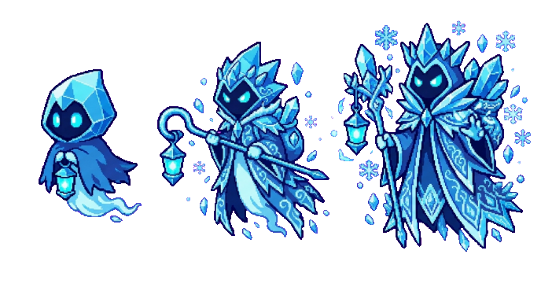

# 09 · Băng Linh (Tuyết Nguyên)

- **Vùng:** Tuyết Nguyên (vùng 0)
- **Loài:** Băng Linh, con số 9 trong 10 loài của vùng. Linh hồn băng đội mũ trùm pha lê, mặt tối với đôi mắt cyan, choàng áo tinh thể, đuôi áo tan thành khói băng, mang đèn lồng băng và gậy / trượng. Dáng người nhỏ đứng thẳng, mảnh, trục dọc.
- **Tên:** Băng Linh, dùng chung cho cả 3 bậc (người dùng tự đổi từ ý tưởng ban đầu "Tuyết Lữ"; chữ "Linh" ở cuối là chủ ý của người dùng).
- **Ảnh:** `09-bang-linh.png` (ở thư mục gốc của nhánh), 688×384, 1 ảnh gồm 3 bậc xếp ngang, trái → phải = Bậc 1 → 2 → 3. Ảnh từ Canva đã có nền trong suốt; đã **xoá dấu sao hồng** ở góc dưới phải, chuyển **alpha cứng 0/255** (ảnh gốc có ~22k pixel bán trong suốt), không thu nhỏ. Còn 48 mảnh rời (bông tuyết, mảnh băng, đèn lồng) là thiết kế, đã giữ.

## Đặc điểm hình ảnh
- Bảng màu xanh băng / xanh dương / cyan / trắng băng, viền navy đậm cùng độ dày ở cả 3 bậc. Không còn bông tuyết tím-hồng (còn ~1k pixel hơi ám tím ở bông tuyết nhỏ).
- Bậc 1: mũ trùm pha lê nhiều mặt, áo choàng xanh, ôm đèn lồng băng, đuôi khói băng.
- Bậc 2: mũ có vương miện tinh thể, mắt cyan, cầm gậy móc treo đèn lồng, túi sau lưng, áo có hoa văn.
- Bậc 3: to nhất, vương miện tinh thể cao, áo choàng dài nhiều hoa văn, tinh thể trên vai, trượng pha lê treo đèn, nhiều bông tuyết quanh.

## Điểm chưa ổn
- Bậc 1 nhìn thẳng hơi nghiêng, Bậc 2-3 nhìn thẳng; không quay trái hẳn như prompt.
- Có đèn lồng băng, gần với ý tưởng Băng Đăng (05); khác ở dáng người mặc áo choàng.
- Bậc 3 chi tiết dày, hiệu ứng (bông tuyết, mảnh băng) tràn ra ngoài thân.
- Không phải lưới pixel đều (~65k màu), giống các con trước.

## Lưu ý khi cắt
- Bậc 2 và Bậc 3: gậy / trượng và đèn lồng nhô ra bên trái; bông tuyết và mảnh băng rời xung quanh: chừa lề rộng cả bốn phía.
- Mắt đọc rõ ở cả 3 bậc, không có chớp sáng đè lên.
