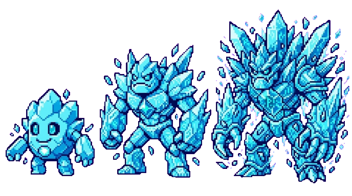

# 10 · Băng Sơn Cự Thú (Tuyết Nguyên, boss)

- **Vùng:** Tuyết Nguyên (vùng 0)
- **Loài:** Băng Sơn Cự Thú, con số 10 (con cuối) trong 10 loài của vùng, là boss của vùng. Sinh vật khổng lồ làm hoàn toàn từ các tinh thể băng ghép lại, dáng đứng hai chân, nặng, nhiều gai tinh thể.
- **Tên:** Băng Sơn Cự Thú, dùng chung cho cả 3 bậc. Đây là tên 4 từ, **chủ ý của người dùng** (đã cân nhắc rút gọn thành Băng Tượng nhưng chọn giữ tên dài vì là boss). Ý định của người dùng: khi người chơi bắt được thì vẫn lấy nguyên tên này; có thể cho người chơi đặt tên riêng, bắt buộc và giới hạn ký tự (chưa quyết, chưa làm vào code).
- **Ảnh:** `10-bang-son-cu-thu.png` (ở thư mục gốc của nhánh), 688×384, 1 ảnh gồm 3 bậc xếp ngang, trái → phải = Bậc 1 → 2 → 3. Ảnh từ Canva đã có nền trong suốt; đã **xoá dấu sao hồng** ở góc dưới phải, chuyển **alpha cứng 0/255** (ảnh gốc có ~24k pixel bán trong suốt), không thu nhỏ. Còn 56 mảnh rời (vụn băng) là thiết kế, đã giữ.

## Đặc điểm hình ảnh
- Bảng màu xanh băng / cyan / trắng băng, viền navy đậm cùng độ dày ở cả 3 bậc, thân sáng.
- Bậc 1: khối tinh thể tròn nhỏ dễ thương, mũ tinh thể trên đầu, mắt tròn to, miệng cười, hạt ngọc sáng ở ngực, hai tay chân ngắn.
- Bậc 2: golem tinh thể hai chân, mặt cau có, gai tinh thể trên vai và lưng, một tay là cụm tinh thể lớn.
- Bậc 3: to nhất, gai tinh thể rất lớn ở lưng và vai, giáp tay có móng vuốt, nhiều vụn băng quanh người.

## Điểm chưa ổn
- **Trùng dáng với Golem Băng Giá (04)**: cùng kiểu golem đứng hai chân nặng. Người dùng đã biết và chọn giữ vì boss làm toàn bằng tinh thể ghép, khác chất liệu và khác bậc 1 (dễ thương).
- Bậc 3: mặt nhỏ lẫn vào gai, mắt không còn cyan sáng như hai bậc đầu, khó đọc ở kích thước nhỏ.
- Vụn băng quanh Bậc 3 có ~1,6k pixel hơi ám tím.
- Không phải lưới pixel đều (~85k màu), giống các con trước.

## Lưu ý khi cắt
- Bậc 3 có vụn băng tràn ra xa thân: chừa lề rộng cả bốn phía, cân nhắc xoá vụn khi ra sprite 128×128.
- Cần kiểm tra lại độ đọc của mắt Bậc 3 khi thu về kích thước sprite.
